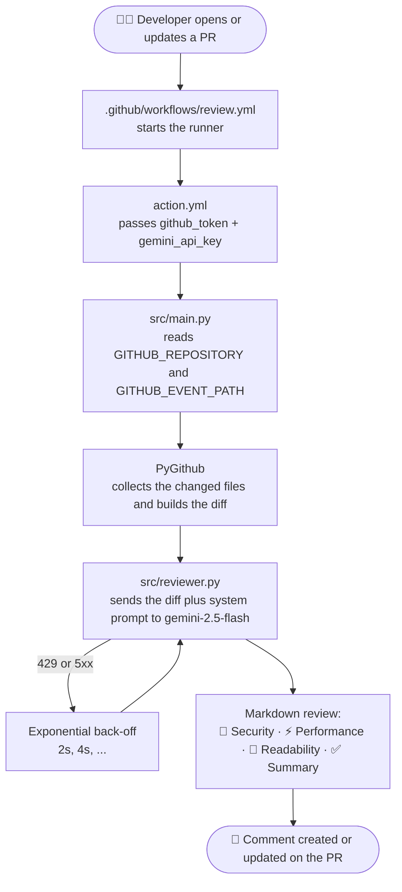

<div align="center">

# 🤖 gemma-pr-reviewer-action

**AI code review on every pull request. Security, performance and readability, in one structured comment.**

[](https://github.com/your-github-username/gemma-pr-reviewer-action/actions/workflows/test-action.yml)
[](LICENSE)
[](https://www.python.org/)
[](https://ai.google.dev/gemini-api/docs)
[](https://docs.github.com/actions)
[](Dockerfile)
[](#contributing)

</div>

---

## ✨ What it does

When a pull request is opened or updated, this action:

1. **Fetches the diff** through the GitHub REST API (`PyGithub`).
2. **Sends it to Gemini** (`gemini-2.5-flash`) through the official `google-genai` SDK.
3. **Audits the change** across three areas:
   - 🔐 **Security**: injection flaws, weak crypto, hardcoded secrets and credentials.
   - ⚡ **Performance**: quadratic loops, N+1 queries, repeated I/O, blocking calls.
   - 🧹 **Readability**: naming, nesting, duplication, non-idiomatic code.
4. **Posts one Markdown comment** on the PR thread, and updates that same comment on later pushes instead of adding noise.

> **About the name:** the project is named after Google's open Gemma model family. The review itself runs on the hosted **Gemini 2.5 Flash** model, which you can change with the `model` input.

## 🔄 Workflow at a glance



## 🧱 Architecture

| File | Responsibility |
| --- | --- |
| `action.yml` | Action metadata: inputs (`gemini_api_key`, `github_token`, ...) and Docker runtime. |
| `Dockerfile` | Builds the container the runner executes. Only `src/` and the dependencies ship in the image. |
| `src/main.py` | Entrypoint. Validates the environment, loads the event payload, finds the PR number, orchestrates the run, and turns failures into GitHub annotations. |
| `src/reviewer.py` | Core logic: diff assembly, prompt, Gemini call with retries, comment formatting, create-or-update posting. No GitHub Actions specifics, so it is easy to test and reuse. |
| `tests/` | `pytest` suite. GitHub and Gemini are mocked with `unittest.mock`, so tests need no network or API key. |
| `.github/workflows/test-action.yml` | CI: unit tests on Python 3.11 and 3.12, a Docker build check, and a self-review of this repo's own PRs. |

### Design decisions

- **Resilient API calls.** HTTP 429 and transient 5xx errors are retried with exponential back-off. A persistent failure raises a specific exception (`RateLimitError`, `ReviewGenerationError`), and errors such as a bad request fail immediately.
- **Never blocks a merge by default.** Rate limits and API outages produce a workflow warning and exit 0. Set `fail_on_error: true` to make them fail the step. Misconfiguration (missing key or token) always fails loudly.
- **Large PRs are handled.** Lock files, minified bundles, source maps and binary files are skipped. Diffs over `max_diff_chars` are truncated on a line boundary and the review says so.
- **Prompt-injection aware.** The diff and PR text are wrapped in `<diff>` tags and declared untrusted in both the system and user prompts.
- **Secrets stay secret.** The prompt tells the model to show at most four characters of any leaked credential and to recommend rotation.
- **One comment per PR.** A hidden HTML marker lets the action find and edit its previous review.

## 🚀 Quickstart

### 1. Get a Gemini API key

Create a key in [Google AI Studio](https://aistudio.google.com/apikey).

### 2. Store it as a repository secret

In your repository go to **Settings → Secrets and variables → Actions → New repository secret** and add:

| Name | Value |
| --- | --- |
| `GEMINI_API_KEY` | the key from step 1 |

`GITHUB_TOKEN` is provided automatically by GitHub; you do not need to create it.

### 3. Add the workflow

Create `.github/workflows/review.yml` in the repository you want reviewed:

```yaml
name: Gemini PR Review

on:
  pull_request:
    types: [opened, synchronize, reopened, ready_for_review]

permissions:
  contents: read
  pull-requests: write

jobs:
  review:
    # Secrets are not exposed to pull requests from forks.
    if: github.event.pull_request.head.repo.full_name == github.repository
    runs-on: ubuntu-latest
    steps:
      - uses: your-github-username/gemma-pr-reviewer-action@v1
        with:
          gemini_api_key: ${{ secrets.GEMINI_API_KEY }}
          github_token: ${{ secrets.GITHUB_TOKEN }}
```

No `actions/checkout` step is needed: the action reads the diff through the API.

### 4. Open a pull request

Push a branch, open a PR, and the review appears within a minute. Every new push updates the same comment.

> Docker actions run on **Linux runners** (`ubuntu-*`) only.

## ⚙️ Inputs

| Input | Required | Default | Description |
| --- | :---: | --- | --- |
| `gemini_api_key` | ✅ | | Gemini API key. Always pass it from a secret. |
| `github_token` | ✅ | `${{ github.token }}` | Token used to read the PR and post the comment. Needs `pull-requests: write`. |
| `model` | | `gemini-2.5-flash` | Gemini model used for the review. |
| `max_diff_chars` | | `100000` | Diffs longer than this are truncated before being sent. |
| `fail_on_error` | | `false` | Fail the step when the review cannot be produced. |

## 📝 Example output

```markdown
# 🤖 Gemma PR Review

## 🔐 Security
- 🔴 High · `app/auth.py` L4: A password is hardcoded (`Supe…`). Move it to a secret store and rotate it.
- 🔴 High · `app/auth.py` L10: The SQL query is built with string concatenation, which allows injection.
  Use a parameterized query: `cur.execute("SELECT * FROM users WHERE name = ?", (username,))`.
- 🟠 Medium · `app/auth.py` L16: MD5 is unsuitable for passwords. Use `bcrypt` or `argon2`.

## ⚡ Performance
- 🟠 Medium · `app/auth.py` L21-24: `find_duplicates` is O(n³). A `set`/`Counter` makes it O(n).

## 🧹 Readability & Idiomatic Improvements
- 🟡 Low · `app/auth.py` L28-33: Replace `== True` and the nested `if`s with `return int(x and y and z)`.

## ✅ Summary
Merge after fixing the two high-severity security issues.
```

## 🧪 Local development

```bash
git clone https://github.com/your-github-username/gemma-pr-reviewer-action.git
cd gemma-pr-reviewer-action
python -m venv .venv && source .venv/bin/activate
pip install -r requirements.txt
python -m pytest -v
```

The tests mock both GitHub and Gemini, so they run offline and need no credentials. `tests/sample_diff.txt` is a realistic diff with a hardcoded secret, SQL injection, weak hashing and a cubic loop.

To exercise the container locally:

```bash
docker build -t gemma-pr-reviewer-action .
```

## 🛠️ Troubleshooting

| Symptom | Cause and fix |
| --- | --- |
| `No Gemini API key found` | The `GEMINI_API_KEY` secret is missing, or the PR comes from a fork (GitHub hides secrets from fork PRs). |
| `Resource not accessible by integration` | Add `permissions: pull-requests: write` to the workflow or job. |
| Warning about rate limits | The free Gemini tier has low quotas. The action already retries; consider a paid key or a smaller `max_diff_chars`. |
| `Nothing to review` notice | The PR only changes binary, generated or lock files. |

## ⚠️ Limitations

- AI feedback can be wrong or miss problems. Treat it as a first reviewer, not a replacement for human review or a security audit.
- The diff, including any secrets inside it, is sent to the Gemini API. Do not use this action on code you are not allowed to share with Google's API.
- Fork PRs are not reviewed because GitHub does not expose secrets to them.

## 🤝 Contributing

Issues and pull requests are welcome. Please run `python -m pytest` before opening a PR; CI also runs the suite on Python 3.11 and 3.12.

## 📄 License

Licensed under the [Apache License, Version 2.0](LICENSE).
